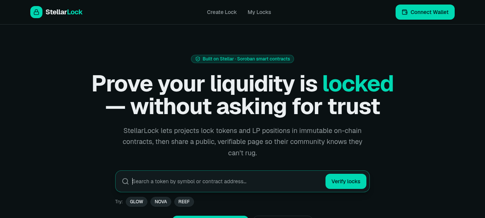
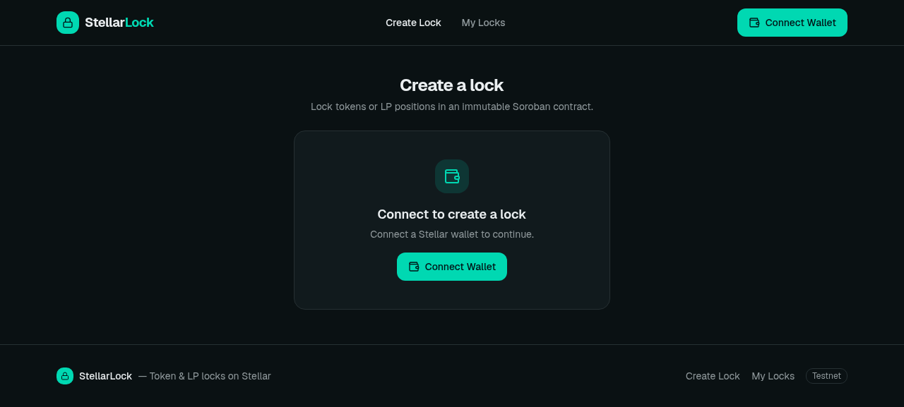
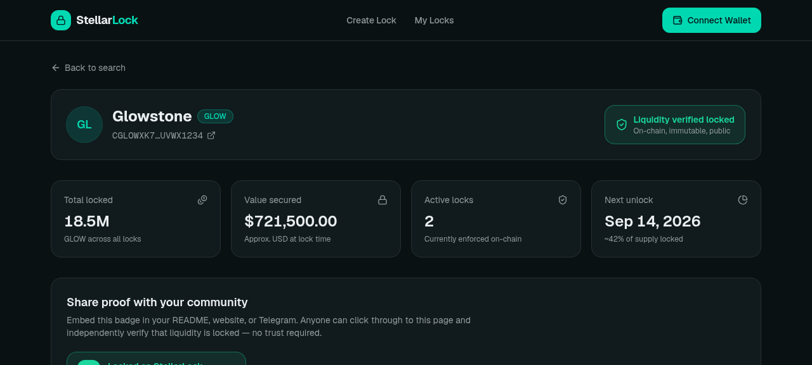
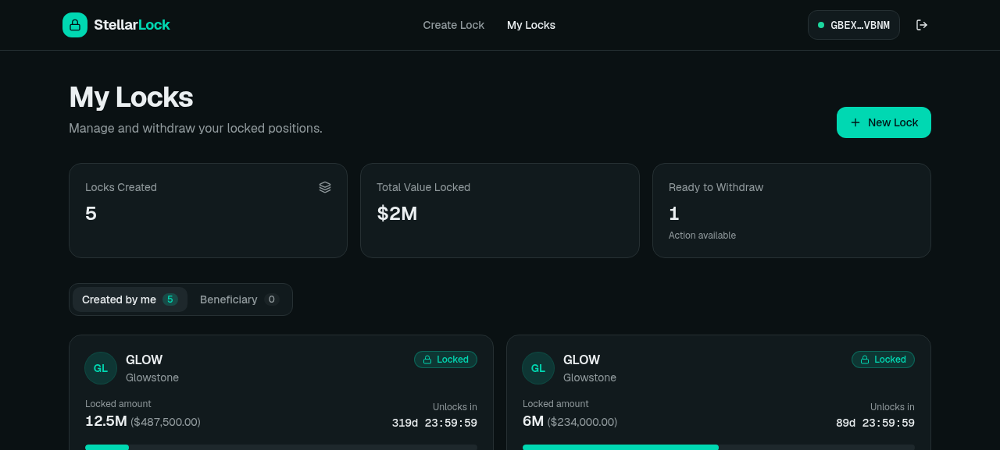
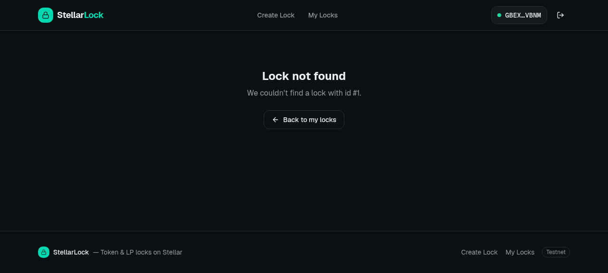

# StellarLock

Token and LP liquidity lock platform built on [Stellar Soroban](https://soroban.stellar.org). Lock tokens or LP pool shares in an immutable on-chain contract, then share a public verifiable link so your community knows the liquidity can't be rugged.



## Features

- **Token locks** — lock any SEP-41 token until a chosen date, with optional linear vesting
- **LP locks** — lock Aquarius or Soroswap pool share tokens
- **Split locks** — create atomic multi-beneficiary locks (2–10 beneficiaries) in a single transaction with proportional shares
- **Public explorer** — anyone can verify locks by token contract address
- **Extend locks** — creators can extend the unlock date, never shorten it
- **Beneficiary model & transfer** — creator and beneficiary can be different addresses (vesting, team grants) with beneficiary transfer support
- **Emergency pause & admin safety** — circuit breaker pause and two-step admin transfer protection
- **Freighter wallet** integration

## Live Contracts (Testnet)

| Contract | Address |
|---|---|
| Token Locker | `CBFCKEOQRQIXKLGU4QBUQVOINOKFBOXJ37LXEKLKNUO6TW4FNGDU26AW` |
| LP Locker | `CA3WYETNIF5IAF3VUNQ3SYKZFV45TOFBF7CEZ46I7QEBPWTRM73WLEI4` |

## Stack

| Layer | Tech |
|---|---|
| Smart contracts | Rust / Soroban SDK 22 |
| Frontend | React 19, TypeScript, Vite, Tailwind CSS v4 |
| Wallet | Freighter via `@stellar/freighter-api` |
| RPC | Soroban Testnet RPC |

## Project Structure

```
├── contracts/
│   ├── token-locker/   # SEP-41 token lock contract
│   ├── lp-locker/      # LP pool share lock contract
│   └── deploy.sh       # Deploy both contracts to testnet
├── src/
│   ├── components/     # UI components
│   ├── hooks/          # useWallet, useLocks, useAsync
│   ├── lib/            # Contract bindings, RPC client
│   ├── pages/          # CreateLock, MyLocks, LockDetail, Explorer
│   └── types/          # Shared TypeScript types
```

## Getting Started

### Prerequisites

- [Node.js](https://nodejs.org) 22 (see `.nvmrc` — managed automatically by `nvm`, `fnm`, etc.)
- [pnpm](https://pnpm.io) — `npm install -g pnpm`
- [Freighter](https://www.freighter.app) browser extension set to **Testnet**

### Environments

Three environment templates are provided:

| File | Network | Purpose |
|---|---|---|
| `.env.testnet` | Soroban Testnet | Local development and CI |
| `.env.staging` | Mainnet (staging contracts) | QA / pre-production sign-off |
| `.env.mainnet` | Mainnet | Production |

Copy the template for the environment you want to use:

```bash
cp .env.testnet .env   # testnet (default)
cp .env.staging .env   # staging
cp .env.mainnet .env   # mainnet
```

Or use the pnpm scripts, which copy automatically before starting:

```bash
pnpm dev              # uses existing .env
pnpm dev:testnet      # copies .env.testnet then starts Vite
pnpm dev:staging      # copies .env.staging then starts Vite

pnpm build            # uses existing .env
pnpm build:testnet    # copies .env.testnet then builds
pnpm build:staging    # copies .env.staging then builds
pnpm build:mainnet    # copies .env.mainnet then builds
```

#### Required variables

| Variable | Description |
|---|---|
| `VITE_NETWORK` | `testnet`, `staging`, or `mainnet` |
| `VITE_RPC_URL` | Soroban RPC endpoint |
| `VITE_HORIZON_URL` | Horizon REST endpoint |
| `VITE_TOKEN_LOCKER_CONTRACT` | Deployed token locker contract ID |
| `VITE_LP_LOCKER_CONTRACT` | Deployed LP locker contract ID |
| `VITE_CONTRACT_ENV` | `testnet` or `mainnet` — selects addresses from `contracts/registry.json` |
| `VITE_CONTRACT_VERSION` | Contract version, e.g. `v1` |

Optional: `VITE_PLAUSIBLE_DOMAIN`, `VITE_PLAUSIBLE_API_HOST`, `VITE_SENTRY_DSN`, `VITE_APP_URL`.

The app validates all required variables at startup and throws a clear error listing any that are missing — the page will not load until they are set.

#### Environment badge

A `DEV` (blue) or `STAGING` (amber) badge appears in the Navbar header when `VITE_NETWORK` is not `mainnet`. The badge is invisible in production builds.

### Run locally

```bash
pnpm install
pnpm dev:testnet
```

Open [http://localhost:5173](http://localhost:5173).

### Docker (alternative)

A fully containerised dev environment is available for contributors who don't want to install Node.js, pnpm, Rust, or the Soroban CLI locally.

#### Prerequisites

- [Docker](https://docs.docker.com/get-docker/) 24+
- [Docker Compose](https://docs.docker.com/compose/) v2 (bundled with Docker Desktop)

#### Start the frontend dev server

```bash
# Copy the testnet environment template first
cp .env.testnet .env

# Build the image and start Vite (hot-reload enabled)
docker-compose up frontend
```

Open [http://localhost:5173](http://localhost:5173). Any code change you make on your host machine is reflected immediately thanks to the source-tree volume mount.

#### Build Soroban contracts

```bash
docker-compose run --rm contracts build
```

Compiled WASMs land in `contracts/target/wasm32v1-none/release/`.

#### Run Rust contract tests

```bash
docker-compose run --rm contracts test
```

This runs `cargo test` inside the contracts workspace with the full Rust + Soroban SDK environment.

#### Run the indexer and notification worker

```bash
docker-compose --profile backend up indexer notifier
```

Both share a SQLite index on the `indexer-data` volume. See [Indexer & notification worker](#indexer--notification-worker) for the required environment variables.

#### Docker files

| File | Purpose |
|---|---|
| `Dockerfile.dev` | Frontend — Node 22 + pnpm, dependency layer caching |
| `Dockerfile.contracts` | Contracts — Rust + Soroban CLI |
| `docker-compose.yml` | Orchestrates the frontend, contracts, indexer and notifier services |
| `.dockerignore` | Excludes `node_modules`, `target`, build artifacts, and secrets |

### Build

```bash
pnpm build:mainnet
```

### Indexer & notification worker

`/api/indexer-*` and the notification-subscription feature read a SQLite index that is kept up to date by two long-running Node processes. Run each one in its own terminal:

```bash
pnpm indexer:start    # polls Soroban contract events into the index (every INDEXER_POLL_INTERVAL_MS, default 10s)
pnpm notifier:start   # sends 7d / 1d / at-unlock reminders (every NOTIFIER_INTERVAL_MS, default 1h)
```

See [docs/indexer-architecture.md](docs/indexer-architecture.md) for event idempotency, cursor recovery, and release accounting details.

| Variable | Used by | Purpose |
|---|---|---|
| `LOCK_INDEX_DB_PATH` | both, and `api/` | SQLite file path (default `lock-index.sqlite`). Must be the same file for every process. |
| `SOROBAN_RPC_URL` | indexer | RPC endpoint (default testnet) |
| `TOKEN_LOCKER_CONTRACT`, `LP_LOCKER_CONTRACT` | indexer | Contracts to index. At least one is required. |
| `RESEND_API_KEY`, `EMAIL_FROM` | notifier | Email delivery. Emails are skipped if the key is unset. |
| `WEBHOOK_SECRET` | notifier | HMAC key for the `X-StellarLock-Signature` header |
| `INDEXER_POLL_INTERVAL_MS`, `INDEXER_RPC_TIMEOUT_MS` | indexer | Poll interval (default 10s) and per-RPC-call timeout (default 15s) |
| `NOTIFIER_INTERVAL_MS` | notifier | Run interval (default 1h) |
| `PUBLIC_APP_URL` | notifier | Base URL for links in reminders (default `https://app.stellarlock.xyz`) |

The full list, with required/optional status and defaults, is in the **Indexer & notifier (server-side)** section of [`.env.example`](.env.example).

## Smart Contracts

### Build

Requires [Rust](https://rustup.rs) and the [Stellar CLI](https://developers.stellar.org/docs/tools/developer-tools/stellar-cli).

```bash
cd contracts
stellar contract build
```

Compiled WASMs land in `contracts/target/wasm32v1-none/release/`.

### Deploy

```bash
# Create and fund a testnet account
stellar keys generate myaccount --network testnet
stellar keys fund myaccount --network testnet

# Deploy both contracts
cd contracts
./deploy.sh myaccount
```

Paste the printed contract IDs into `src/lib/stellar.ts` under `CONTRACTS`.

### Monitoring

- Visit `/health` for a lightweight browser-facing status page.
- Monitor `/api/health` for a structured JSON payload and `/api/readiness` for readiness checks.
- External analytics and font assets use SRI and crossorigin attributes where supported.

### Contract API

For authoritative contract interface details, storage layout, invariants, and split lock specifications, see [contracts/README.md](contracts/README.md).

#### Token Locker

| Function | Description |
|---|---|
| `create_lock(creator, token, amount, beneficiary, unlock_at, vesting?)` | Lock tokens, returns lock id |
| `create_split_lock(creator, token, total_amount, beneficiaries, unlock_at, vesting?)` | Lock tokens split across 2–10 beneficiaries, returns group id |
| `withdraw(id)` | Beneficiary withdraws after unlock |
| `extend(id, new_unlock_at)` | Creator extends unlock date |
| `transfer_beneficiary(id, new_beneficiary)` | Beneficiary transfers lock ownership |
| `bump_lock_ttl(id)` | Extends TTL for persistent lock and instance entries |
| `get_lock(id)` | Fetch a single lock |
| `get_locks_by_creator(address, offset, limit)` | Locks created by address (paginated) |
| `get_locks_by_beneficiary(address, offset, limit)` | Locks where address is beneficiary (paginated) |
| `get_locks_by_token(token, offset, limit)` | Locks for a token (powers the explorer, paginated) |
| `get_lock_count_by_creator(address)` | Total lock count for a creator |
| `get_lock_count_by_beneficiary(address)` | Total lock count for a beneficiary |
| `get_lock_count_by_token(token)` | Total lock count for a token |
| `get_split_group(group_id)` | Fetch a split group record and its sub-lock IDs |
| `get_split_groups_by_creator(creator, offset, limit)` | Split groups created by address (paginated) |
| `get_total_locked(token)` | TVL currently locked for a token |
| `get_global_stats()` | Total lock count and unique token count across the contract |
| `init(admin)` | Set admin once after deployment |
| `get_admin()` | Return current contract admin |
| `propose_admin(new_admin)` | Step 1 of two-step admin transfer |
| `accept_admin()` | Step 2 of two-step admin transfer |
| `pause()` | Emergency pause: blocks creation, withdrawal, extension, transfers |
| `unpause()` | Unpause the contract |
| `propose_upgrade(wasm_hash)` | Queue a WASM upgrade (7-day timelock) |
| `execute_upgrade()` | Apply upgrade after timelock elapses |
| `cancel_upgrade()` | Cancel a pending upgrade |

#### LP Locker

Same shape as Token Locker, minus vesting, plus `dex`, `token_a`, `token_b` fields. Supports `create_split_lock`, `get_split_group`, `get_split_groups_by_creator`, and shares the same `init`, `get_admin`, `propose_admin`, `accept_admin`, `pause`, `unpause`, `propose_upgrade`, `execute_upgrade`, `cancel_upgrade` API. Detailed in [contracts/README.md](contracts/README.md).

## Screenshots

| | |
|---|---|
|  |  |
|  |  |

## Upgrade Policy

Both contracts implement an **admin upgrade with a 7-day timelock**.

- Immutability is the default — no admin means no upgrades.
- After deployment, call `init(admin)` once to register an admin. If `init` is never called, the contract is permanently immutable.
- When an upgrade is needed, the admin calls `propose_upgrade(new_wasm_hash)`. The proposal is stored on-chain with an `execute_after` timestamp 7 days in the future.
- Anyone can observe the pending proposal on-chain during the 7-day window.
- After 7 days, the admin calls `execute_upgrade()` to apply the new WASM. All persistent lock state is preserved across upgrades.
- The admin can call `cancel_upgrade()` at any time to abort a pending proposal.
- All upgrade events (`upgrade_proposed`, `upgrade_cancelled`) are emitted on-chain.

Admin ownership can be transferred without changing the upgrade timelock. The current admin first nominates a replacement with `propose_admin(new_admin)`. The nominated address must authenticate a separate `accept_admin()` call; only then does it become the admin. Until acceptance, the current admin remains active. `get_admin()` returns the current admin, or `None` before initialization.

| Function | Who | Effect |
|---|---|---|
| `init(admin)` | deployer (once) | Sets the admin address |
| `get_admin()` | anyone | Returns the current admin, if initialized |
| `propose_admin(new_admin)` | current admin | Stores a pending admin nomination |
| `accept_admin()` | pending admin | Completes the two-step transfer and clears the pending nomination |
| `propose_upgrade(wasm_hash)` | admin | Queues upgrade, 7-day delay |
| `execute_upgrade()` | admin | Applies upgrade after delay |
| `cancel_upgrade()` | admin | Cancels pending proposal |
| `pause()` | admin | Blocks lock lifecycle writes until `unpause()` |
| `unpause()` | admin | Restores normal lock lifecycle writes |

`pause()` and `unpause()` are emergency controls on each contract independently. While paused, non-admin write operations such as lock creation, withdrawal, extension, and beneficiary transfer fail with `ContractPaused`; read-only queries and admin/governance functions remain available. A pending upgrade can still execute after its timelock, so operators should cancel an unsafe pending upgrade separately. See [docs/incident-response.md](docs/incident-response.md) for the response workflow.

> The upgrade path exists solely for critical security fixes. User lock funds are held in persistent storage and are unaffected by WASM upgrades.

## Documentation

Architecture notes, runbooks, ADRs and other project documentation are indexed in **[docs/README.md](docs/README.md)**.

## Troubleshooting

Hitting a wallet connection failure, wrong-network error, stuck transaction, or a contract rejection? See **[docs/troubleshooting.md](docs/troubleshooting.md)** for a full list of error cases with causes and fixes.

## Security

Found a security vulnerability? Please read our [Security Policy](SECURITY.md) before reporting. Do not open public issues for security vulnerabilities.

## License

MIT

## Handsoff notes

<!-- handsoff-issue-778 -->
- #778: Lock-creation 'Lock Details' metadata section ignores its own i18n keys in both forms

<!-- handsoff-issue-779 -->
- #779: CreateLpLockForm's beneficiary field has no i18n key at all, unlike CreateTokenLockForm's
<!-- handsoff-issue-785 -->
- #785: NotificationSettings validates the email address but saves the webhook URL with no format check

<!-- handsoff-issue-724 -->
- #724: No test coverage for pause()/unpause() actually blocking state-mutating calls

<!-- handsoff-issue-725 -->
- #725: No test coverage for MIN/MAX lock-duration bounds (LockDurationTooShort/LockDurationTooLong)

<!-- handsoff-issue-726 -->
- #726: No test coverage for extend()'s ExtensionLimitExceeded / MAX_EXTENSIONS cap

<!-- handsoff-issue-727 -->
- #727: No test coverage for lp-locker's IdenticalTokens check
<!-- handsoff-issue-720 -->
- #720: execute_upgrade performs the WASM upgrade without emitting an event

<!-- handsoff-issue-721 -->
- #721: init() has no event emission for contract initialization

<!-- handsoff-issue-722 -->
- #722: init() panics instead of returning a typed ContractError when already initialized

<!-- handsoff-issue-723 -->
- #723: Dead/unused ContractError::NotAdmin variant left in both contracts after the NotInitialized fix
<!-- handsoff-issue-728 -->
- #728: token-locker has no pagination test for get_split_groups_by_creator (unlike lp-locker)

<!-- handsoff-issue-729 -->
- #729: No test coverage for the token-locker create_split_lock TVL/global-stats gap

<!-- handsoff-issue-730 -->
- #730: No test coverage for a zero-vesting-start / malicious Vesting.released input at lock creation

<!-- handsoff-issue-731 -->
- #731: remove_from_index rebuilds the entire index Vec on every transfer_beneficiary call
